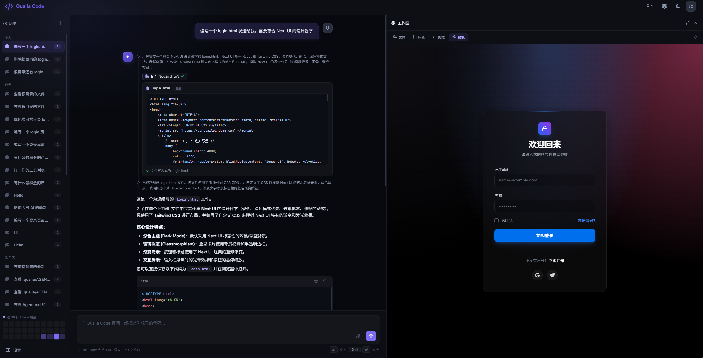
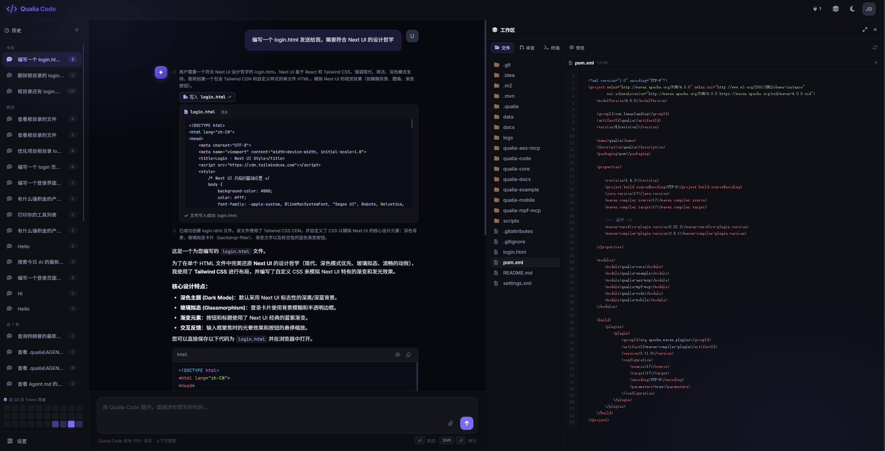
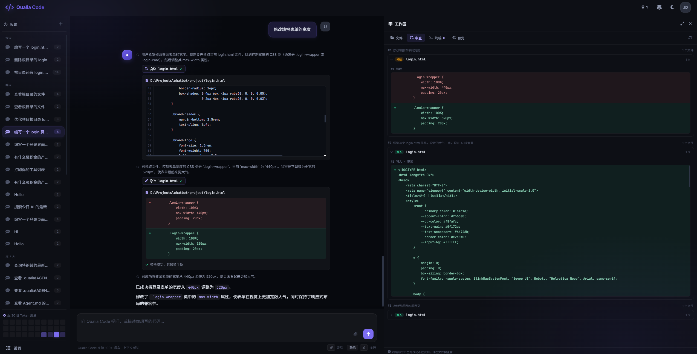
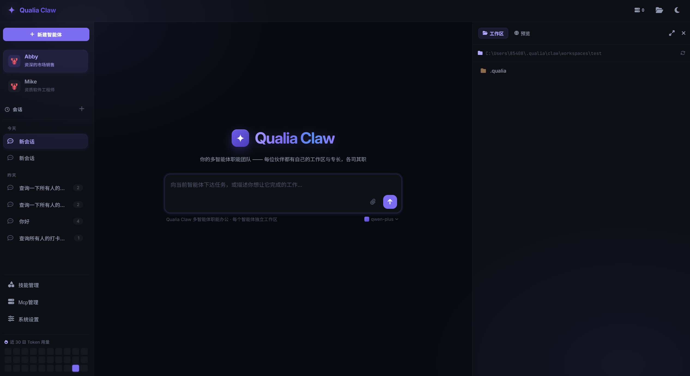
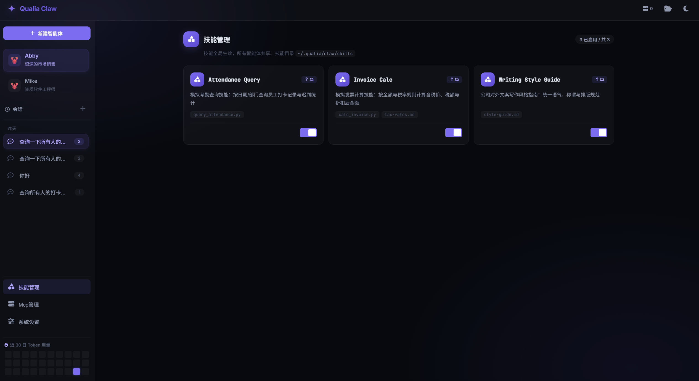
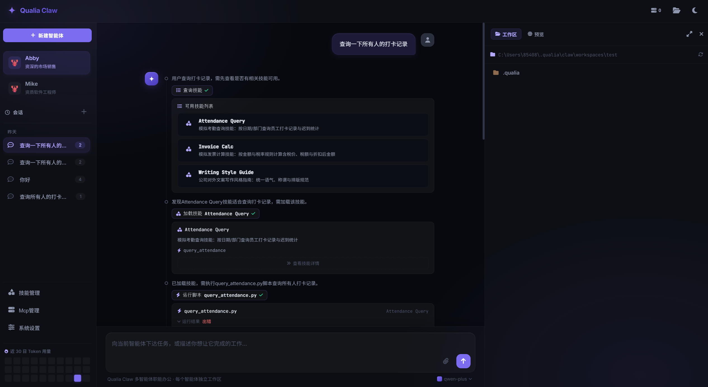

<div align="center">

# Qualia

**Enterprise-grade Java AI Agent Framework**

*Build LLM-driven intelligent applications quickly with the ReAct pattern and MCP toolchain integration*

[](https://central.sonatype.com/artifact/cn.lunarlanding/qualia-core)
[](LICENSE)
[](https://adoptium.net/)
[](https://spring.io/projects/spring-boot)
[](https://maven.apache.org/)
[](https://modelcontextprotocol.io/)

[Quick Start](#-quick-start) · [Showcase](#showcase) · [Release](#-release)

**English** | [简体中文](README.zh-CN.md) | [日本語](README.ja.md) | [한국어](README.ko.md)

</div>

---

## Overview

Qualia is a lightweight, modular Java framework for building LLM-powered agent applications. It provides a complete agent development framework with multi-model access, tool invocation, knowledge base retrieval, and skill extension capabilities, suitable for building enterprise AI assistants, intelligent customer service, code assistants, and more.

Based on the ReAct (Reasoning + Acting) paradigm, it supports complex task decomposition through think-act-observe loops; a unified interface adapts to mainstream LLMs such as DashScope, OpenAI, and Claude; an annotation-driven tool system with MCP protocol integration makes tool capabilities easy to extend; JSON/MySQL-based conversation memory management supports sliding windows and summary compression; and a skill system with reusable prompt templates and script execution supports progressive loading.

## Modules

```
qualia/
├── qualia-core/          # Core module
└── qualia-docs/          # Project documentation
```

**Qualia-core** The framework core module, providing the agent core architecture (ReActAgent, HarnessAgent), the model protocol abstraction layer (ChatModel, EmbeddingModel, RerankModel), the tool system and MCP integration, conversation memory management, the RAG retrieval pipeline, and the skill system.

**Qualia-code** An AI coding assistant product built on the Qualia framework, delivering a complete Web IDE experience: multi-session management and workspace switching, code generation and analysis, file read/write and search, terminal command execution, tool-call visualization, MCP server management, multi-model configuration with dynamic switching, streaming responses and real-time interaction, available in both desktop and web deployment modes. It now lives in its own repository together with its Vue front end (`qualia-code-ui`) and SWT desktop shell (`qualia-code-desktop`), consuming `qualia-core` from Maven Central.

**Qualia-claw** A multi-agent collaboration product built on the Qualia framework. Each agent has its own workstation (system-managed workspace + independent conversation memory), supporting role personas, parallel multi-agent conversations, global skills and MCP servers referenced via per-agent allowlists, workspace file browsing and preview, and per-session token usage statistics. All configuration is consolidated in the user home directory, isolated per product, and it likewise supports both desktop and web deployment modes. It has also been split out of this repository and consumes `qualia-core` from Maven Central as a regular dependency.

## 🚀 Quick Start

### Installation

qualia-core is available on Maven Central. Add the following dependency to your project `pom.xml`:

```xml
<dependency>
    <groupId>cn.lunarlanding</groupId>
    <artifactId>qualia-core</artifactId>
    <version>${latest}</version>
</dependency>
```

### 5-Minute Tutorial

```java
// 1. Initialize the model and memory
ChatModel model = new DashscopeChatModel("your-api-key", "qwen-turbo");
Memory memory = new InMemoryMemory();

// 2. Create an agent and register tools
ReActAgent agent = new ReActAgent(model, memory);
agent.setSystemPrompt("You are a professional intelligent assistant.");

// Register tools (annotation-driven)
agent.registerToolsFrom(new MyTools());

// 3. Run a conversation
AgentResponse response = agent.call("session-1", "Search for the latest AI breakthroughs");
System.out.println(response.getAnswer());

// 4. Streaming invocation
Flux<AgentResponse> stream = agent.callStream("session-1", "Explain quantum computing");
stream.subscribe(step -> System.out.println(step.getAnswer()));

// Tool class definition
public class MyTools {
    @AsFunctionTool(name = "search", description = "Search the internet for information")
    public String search(@Param("query") String query) {
        // Search logic
        return "search results";
    }
}
```

### Showcase

**Qualia Code** is an AI coding assistant product built on the Qualia Core framework, delivering a complete Web IDE experience. It supports multi-session management and workspace switching, code generation and analysis, file read/write and search, and terminal command execution, with tool-call progress visualized. It also provides MCP server management, multi-model configuration with dynamic switching, and global and workspace-level skill extensions, available in both desktop and web deployment modes.







**Qualia Claw** is a multi-agent collaboration product built on the Qualia Core framework. Each agent has its own workstation (system-managed workspace + independent conversation memory), supporting role personas and parallel multi-agent conversations. Global skills and MCP servers are referenced via per-agent allowlists, with built-in workspace file browsing and preview and per-session token usage statistics. All configuration is consolidated in the user home directory, isolated per product, and it likewise supports both desktop and web deployment modes.







## 📦 Release

### Maven Central

qualia-core is published to Maven Central.

```bash
# Publish qualia-core to Maven Central
# Publish the parent POM first (downstream resolution of qualia-core needs it), then the module; -P release also GPG-signs the parent POM
mvn clean deploy -N -P release
mvn clean deploy -pl qualia-core -P release -DskipTests
```

### Build Desktop Apps

This repository no longer ships a desktop shell module: the Qualia Code desktop app is built from its own repository, and the same goes for Qualia Claw.

## 📄 License

This project is licensed under the [Apache License 2.0](LICENSE).
